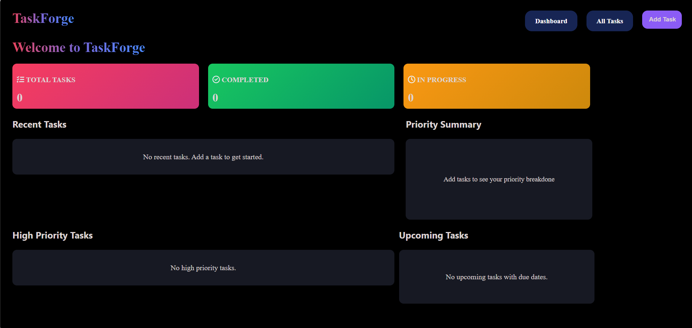
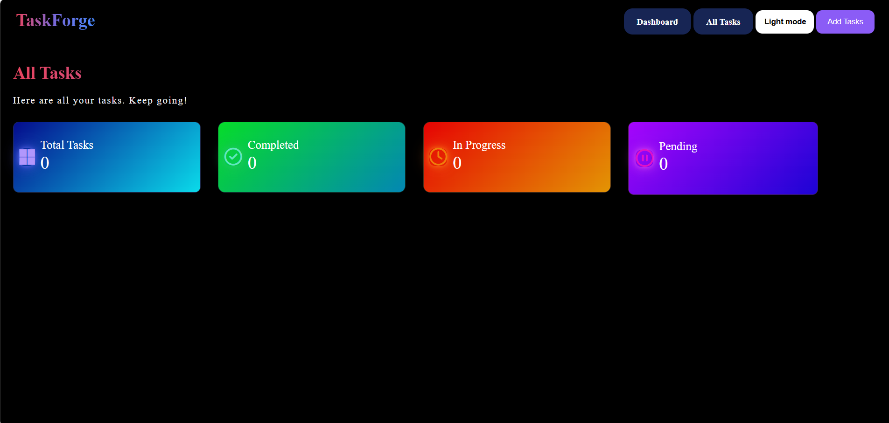
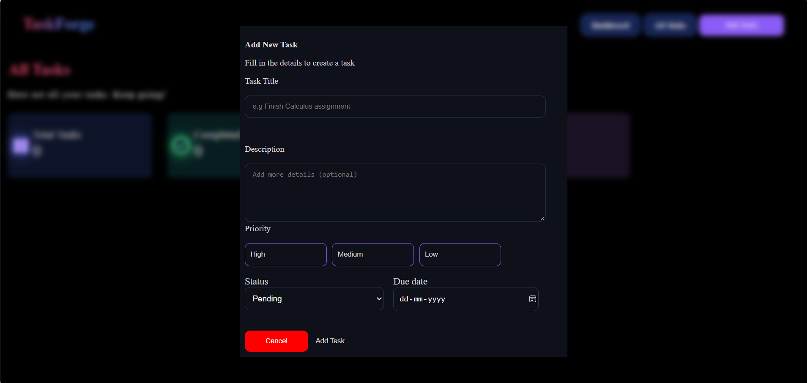
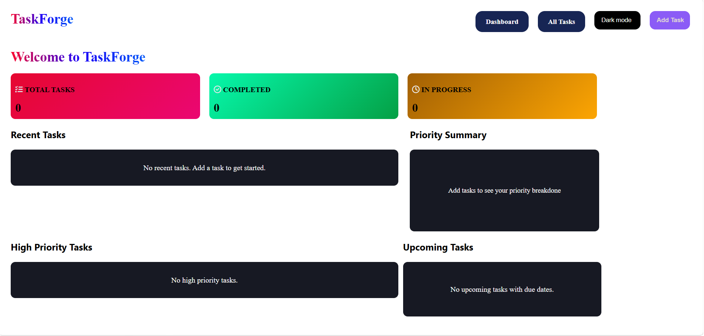
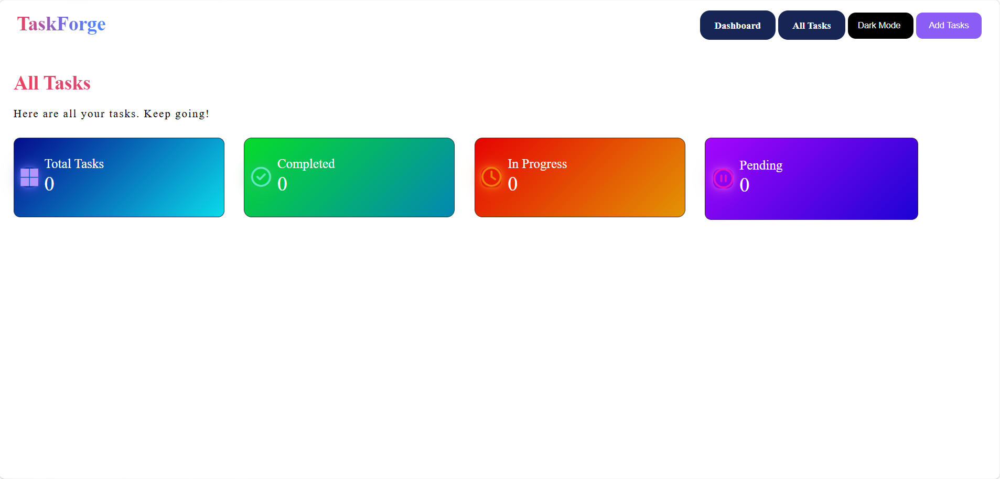
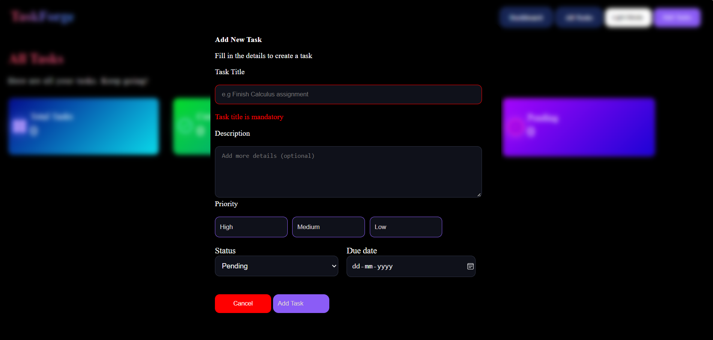
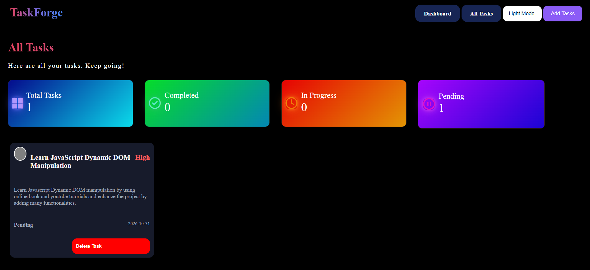
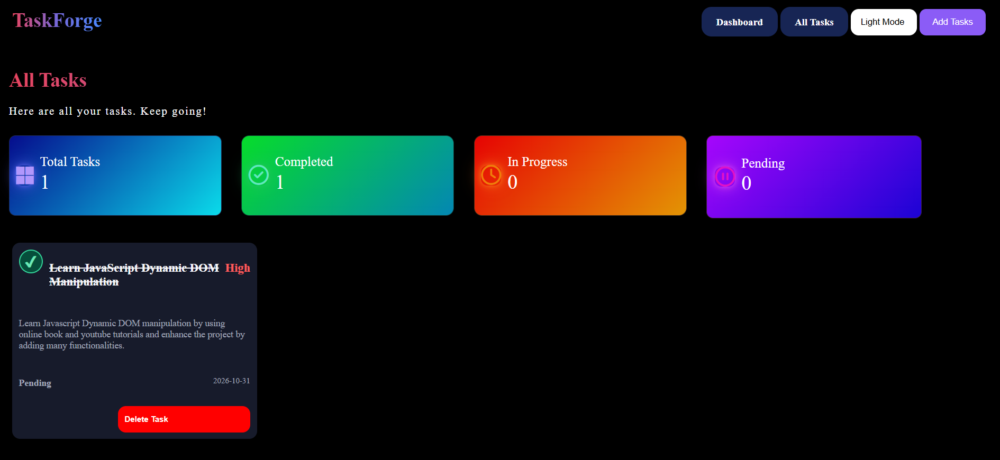

# TaskForge – Task Management Web Application

A beginner-level task management web application developed as part of my journey into frontend web development.

TaskForge is a personal practice project built to strengthen my understanding of **HTML, CSS, JavaScript, DOM manipulation, dynamic element creation, and event handling** by developing an interactive task management interface.

This project is a work in progress. My primary goal is to learn how real-world web interfaces are structured, styled, and made interactive through JavaScript.

---
## Screenshots

### Dashboard - Dark mode


### All Tasks


### Add Tasks


### Dashboard - Light mode


### All Tasks - Light mode


### Adding a Task


### Trying to Add a task with empty title


### Displaying Task card


### Completing a task



## Table of Contents

- [Project Overview](#project-overview)
- [Project Objectives](#project-objectives)
- [Features](#features)
- [Technologies Used](#technologies-used)
- [What I Learned](#what-i-learned)
- [How It Works](#how-it-works)
- [Project Structure](#project-structure)
- [How to Run the Project](#how-to-run-the-project)
- [Current Limitations](#current-limitations)
- [Future Improvements](#future-improvements)
- [Design Reference and Credits](#design-reference-and-credits)
- [Disclaimer](#disclaimer)

---

## Project Overview

TaskForge is a simple task management interface that allows users to create tasks, assign priorities, select task statuses, and manage their tasks through an interactive interface.

The project was developed as a hands-on learning exercise rather than a production-ready application.

Instead of learning web development concepts only through theory, I wanted to apply them by building an actual interface and experimenting with HTML elements, CSS layouts, JavaScript functions, event listeners, and dynamic DOM updates.

The interface was developed using an existing task-manager design as a reference, with the intention of practising frontend development and improving my ability to recreate web interfaces.

**Project type:** Personal learning and practice project  
**Project status:** Work in progress  
**Primary focus:** Frontend development and JavaScript DOM manipulation

---

## Project Objectives

The main objectives of this project are:

- To improve my understanding of HTML page structure and semantic elements.
- To practise CSS styling, layouts, Flexbox, and responsive design.
- To understand how JavaScript interacts with HTML elements through the DOM.
- To learn how to create and insert HTML elements dynamically.
- To handle user interactions using JavaScript event listeners.
- To build interactive forms and modal overlays.
- To practise collecting user input and displaying it dynamically.
- To understand how task status and counters can be updated through JavaScript.
- To develop the habit of building projects, identifying bugs, and improving code incrementally.

---

## Features

The current implementation includes the following functionality:

### 1. Task Creation

Users can enter task information through a form, including:

- Task title
- Task description
- Priority level
- Task status
- Due date

The entered information is used to create a task card on the All Tasks page.

### 2. Dynamic Task Cards

Task cards are created dynamically using JavaScript.

Instead of manually writing every task card in HTML, JavaScript creates the required elements and inserts the task information into the page.

### 3. Priority Selection

Users can select a priority level for a task.

The interface uses different priority options to practise handling button clicks and updating CSS classes through JavaScript.

### 4. Task Status Management

Tasks can have different statuses, such as:

- Pending
- In Progress
- Completed

The interface includes a control for marking tasks as completed or incomplete.

### 5. Delete Tasks

Users can delete task cards from the page.

The task counters are also updated when a task is deleted.

### 6. Task Counters

The interface displays task statistics, including:

- Total tasks
- Completed tasks
- Pending tasks
- In-progress tasks

These counters help practise updating page content dynamically using JavaScript.

### 7. Modal-Based Task Entry

The task-entry form is displayed inside a modal overlay.

This provides an opportunity to practise CSS positioning, including `position: fixed`, `inset: 0`, Flexbox alignment, and overlay styling.

### 8. Basic Responsive Styling

CSS media queries are used to adapt the interface to different screen sizes.

The layout will continue to be tested and improved as the project develops.

---

## Technologies Used

### HTML5

Used to create the structure of the application, including forms, buttons, headings, containers, task sections, and input fields.

### CSS3

Used to style the interface, including:

- Flexbox layouts
- Background colours and gradients
- Borders and border radii
- Modal overlays
- Spacing and alignment
- Responsive media queries
- Interactive visual states

### JavaScript

Used to add functionality to the interface, including:

- Selecting HTML elements
- Handling button clicks
- Reading form inputs
- Creating elements dynamically
- Adding and removing CSS classes
- Updating task counters
- Deleting task cards
- Reading task information from URL parameters

### Font Awesome

Used for interface icons where included in the project.

---

## What I Learned

This project has helped me explore several important frontend development concepts.

### 1. DOM Manipulation

The Document Object Model (DOM) represents the structure of an HTML document as objects that JavaScript can access and modify.

Through this project, I practised selecting elements using methods such as:

- `document.querySelector()`
- `document.querySelectorAll()`

I also practised updating text content, modifying classes, and changing the page in response to user actions.

### 2. Dynamic Element Creation

One of my main learning goals is understanding how JavaScript can create new HTML elements while a webpage is running.

For example, `document.createElement()` can create a new element, and methods such as `appendChild()` can insert it into the document.

This concept is used to build task cards dynamically instead of hardcoding every card in the HTML file.

### 3. Event Handling

I practised using `addEventListener()` to respond to user interactions.

Examples include:

- Opening and closing the task-entry modal
- Selecting task priorities
- Submitting forms
- Marking tasks as completed
- Deleting tasks

These interactions helped me understand how JavaScript connects user actions to changes in the interface.

### 4. CSS Flexbox

I explored Flexbox properties to arrange elements and control their alignment and spacing.

Some of the properties I practised include:

- `display: flex`
- `justify-content`
- `align-items`
- `gap`
- `flex-wrap`

### 5. Modal Overlays and Positioning

The task-entry interface helped me practise positioning an overlay over the webpage.

I explored CSS properties such as:

- `position: fixed`
- `inset: 0`
- `display: flex`
- `justify-content: center`
- `align-items: center`
- `z-index`

I plan to continue studying how these properties work together to position elements correctly.

### 6. Forms and User Input

I practised collecting information from form inputs, validating required fields, and using the entered values to create task cards.

### 7. URL Parameters

The project uses URL parameters to pass task information between pages.

This helped me explore `URLSearchParams` and understand one way of transferring information through a URL.

### 8. Debugging and Iterative Development

While building the project, I encountered layout issues, JavaScript errors, and problems with element selection and event handling.

Working through these issues is part of my learning process. I intend to keep testing the project and improving my understanding rather than treating the current implementation as final.

---

## How It Works

The project currently uses two main HTML pages.

### Dashboard

The dashboard provides the main interface and a form for entering task details.

When a task is submitted, its information is passed to the All Tasks page through URL parameters.

### All Tasks

The All Tasks page reads the available URL parameters and uses JavaScript to create a task card.

The page also provides controls for changing completion state and deleting tasks.

**Important:** This implementation is an early frontend version. It does not yet have a persistent database or reliable long-term storage of tasks.

---

## Project Structure

The main files are organised as follows:

```text
TaskForge/
│
├── dashboard.html
├── all-tasks.html
├── script1.js
├── script2.js
├── styles1.css
├── styles2.css
├── dashboard.png
├── all-tasks.png
├── add-tasks.png
└── README.md
```

- `dashboard.html` — Contains the dashboard interface and task-entry modal.
- `all-tasks.html` — Contains the task list, dynamically generated task cards, and task-management interactions.
- `README.md` — Documents the project, its learning objectives, current features, and planned improvements.

The project may be reorganised as additional features are introduced.

---

## How to Run the Project

1. Clone or download the repository.
2. Open the project folder in a code editor such as Visual Studio Code.
3. Open `dashboard.html` in a web browser.
4. Use the task-entry interface to add a task.
5. Explore the All Tasks page and test the available interactions.

Make sure both HTML files remain in the same folder so the page navigation works as expected.

No backend server or database is currently required for the basic implementation.

---

## Current Limitations

TaskForge is still a learning project and has several limitations.

- Task data is not yet saved persistently.
- Refreshing the page or reopening it may cause previously created tasks to disappear.
- The application has not been fully tested across all browsers and screen sizes.
- Some interactions and edge cases may still contain bugs.
- The project does not currently include a backend or database.
- Authentication and multiple-user support have not been implemented.
- Error handling and accessibility can be improved.

These limitations are acknowledged as part of the current development stage.

---

## Future Improvements

As I continue learning frontend development, I plan to improve TaskForge incrementally.

### Planned frontend improvements

- Improve the layout and responsiveness of task cards.
- Refine the task-entry modal and form validation.
- Improve visual feedback for priority and completion states.
- Add search and filtering options.
- Add sorting by priority or due date.
- Improve keyboard accessibility and usability.
- Refactor repeated JavaScript logic into reusable functions.

### Planned JavaScript improvements

- Separate JavaScript into dedicated files.
- Organise the code into smaller, reusable functions.
- Improve input validation and error handling.
- Strengthen task-state management.
- Practise using browser storage to preserve tasks across page refreshes.

### Possible future enhancements

- Persist task data using LocalStorage.
- Add editing functionality for existing tasks.
- Add task categories and tags.
- Add a calendar or due-date view.
- Explore backend integration and database storage.
- Add user authentication if the project eventually requires it.

These are future goals, not claims about features that are already implemented.

---

## Design Reference and Credits

The visual design of this project was inspired by the **Sanchalak Task Manager**, which I used as a reference while practising frontend development.

I would like to acknowledge the original project and its creator for providing the design reference that helped me practise recreating a task-management interface.

**Original project:** Sanchalak Task Manager  
**Original repository or design URL:** https://sanchalakk.vercel.app/

TaskForge is my practice project name. It is intended as a learning exercise to help me understand how a task-management interface can be structured and implemented using HTML, CSS, and JavaScript.

The project should not be interpreted as an official version of, or an affiliation with, the original Sanchalak project.

If any original source code or assets are reused, the relevant licensing terms and attribution requirements must be respected.

---

## Disclaimer

TaskForge is an educational project developed for personal practice and learning.

It is not a production-ready task management application. Its features, reliability, accessibility, and data persistence are still being improved.

The project is shared publicly to document my learning progress, practise version control with Git and GitHub, and receive feedback from other developers.

Suggestions, constructive feedback, and improvement ideas are welcome.

---

## Final Note

This project represents one step in my journey toward becoming a better web developer.

I am using TaskForge to learn by building, experimenting, debugging, and improving one feature at a time.

**Built for practice. Improved through learning. More features to come.**
